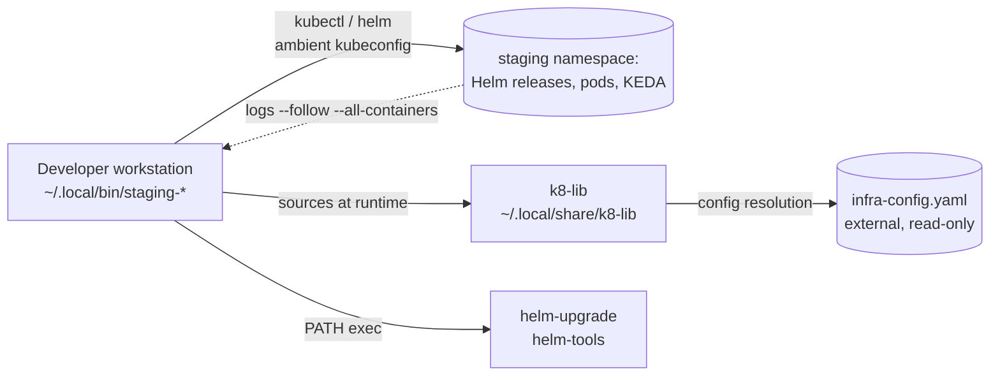

# Threat Model — staging-utils

## Overview

`staging-utils` is four developer-workstation bash wrappers over `kubectl`/`helm`
targeting the staging namespace of the Noizu cluster. It holds **no secrets and no
state of its own**; its real attack surface is borrowed authority: every command
runs with the invoking user's ambient cluster credentials, and each script sources
shared shell code (`k8-lib`) from a user-writable path at runtime. The crown jewels
are (1) the cluster credentials available to the workstation user and (2) every
Helm release living in the namespace the config resolves to — `staging-down` can
uninstall all of them in one invocation.

This is a staging-grade tool: convenience deliberately outranks guardrails, and the
register below documents where that trade is made rather than pretending it away.

## Trust Boundaries

1. **Workstation ↔ cluster API** — `kubectl`/`helm` inherit the ambient kubeconfig
   context's full authority; these tools never scope, prompt, or dry-run it.
2. **Workstation ↔ k8-lib** — `config.sh` / `common.sh` / `assist.sh` are sourced
   from `K8_LIB_DIR` (default `~/.local/share/k8-lib`) at every run; sourced code
   executes with the user's full privileges and credentials.
3. **Configuration ↔ target selection** — `--config`, `K8_STAGING_NAMESPACE`, and
   `K8_APP_PREFIX` decide which namespace and labels are acted on; nothing in the
   scripts validates that the resolved target is actually staging.
4. **Cluster log plane ↔ local terminal** — `staging-logs --follow --all-containers`
   streams every container's output to the workstation unchanged.

## Attack Surface

All four tools are local CLI entry points (`~/.local/bin`); there is no network
listener, no webhook, and no daemon. Egress is only the cluster API calls above.

## Vulnerability Register

| ID | Severity | STRIDE | Component | Status |
|----|----------|--------|-----------|--------|
| T-001 | High | Elevation of privilege | `staging-down` uninstalls **every** Helm release in the resolved namespace with no confirmation, dry-run, or namespace sanity check — a mistyped `--config` or exported `K8_STAGING_NAMESPACE` retargets the sweep | Open (accepted for staging; blast radius limited by kubeconfig RBAC) |
| T-002 | Medium | Tampering / Elevation | `k8-lib` sourced unconditionally from user-writable `K8_LIB_DIR`; tampered lib executes with the user's cluster credentials | Open (trusted-workstation assumption; shared with all k8-lib fleet tools) |
| T-003 | Medium | Information disclosure | `staging-logs` streams all containers' logs unfiltered — staging apps that log secrets expose them to the local terminal/session capture | Open (accepted: staging-grade data) |
| T-004 | Medium | Tampering | `staging-up` execs `helm-upgrade` resolved via `$PATH`; a hijacked PATH runs arbitrary deploy logic with cluster credentials | Open (host PATH hygiene is the only control) |
| T-005 | Low | Repudiation | Destructive actions (`helm uninstall --wait`) leave no audit trail beyond local shell history | Open (accepted; cluster-side audit is out of scope here) |
| T-006 | Low | Denial of service | `staging-up` redeploys with `--force`, restarting in-use staging services without warning | Open (accepted: staging-only impact, KEDA/CI recover) |

## Mitigation Coverage

- **Positive (by design):** no secret values are read, passed, or printed by any
  tool — secrets flow through the Infisical → k8s Secrets infra path elsewhere
  (documented in PROJ-SCHEMA.md). There is no listener and no daemon to expose.
- **Partial:** T-001's blast radius is bounded only by the ambient kubeconfig's
  RBAC and by naming convention on the namespace; no in-repo control exists.
- **Open items** T-001 – T-006 are all "accepted staging trade-offs" as of
  2026-10-26; none track an issue. Revisit if any tool is pointed at a non-staging
  namespace or gains a scheduled/non-interactive caller.

## Residual Risk

Accepted: a compromised workstation or tampered k8-lib yields full cluster
credentials (T-002/T-004); an operator error can mass-uninstall a namespace
(T-001). Both are inherent to thin local wrappers around kubectl/helm and are
considered acceptable for a developer staging utility — the same trust model as
`kubectl` itself. No Critical findings.

→ *Trust-boundary context: [PROJ-ARCH.md](PROJ-ARCH.md) · config surface:
[PROJ-SCHEMA.md](PROJ-SCHEMA.md)*
